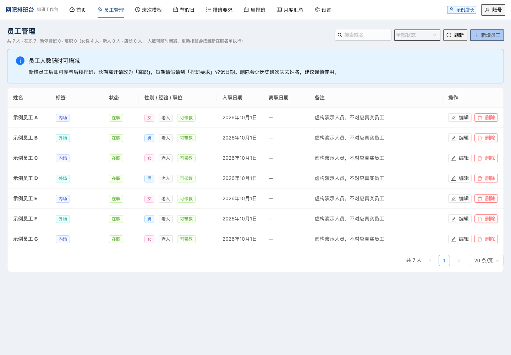
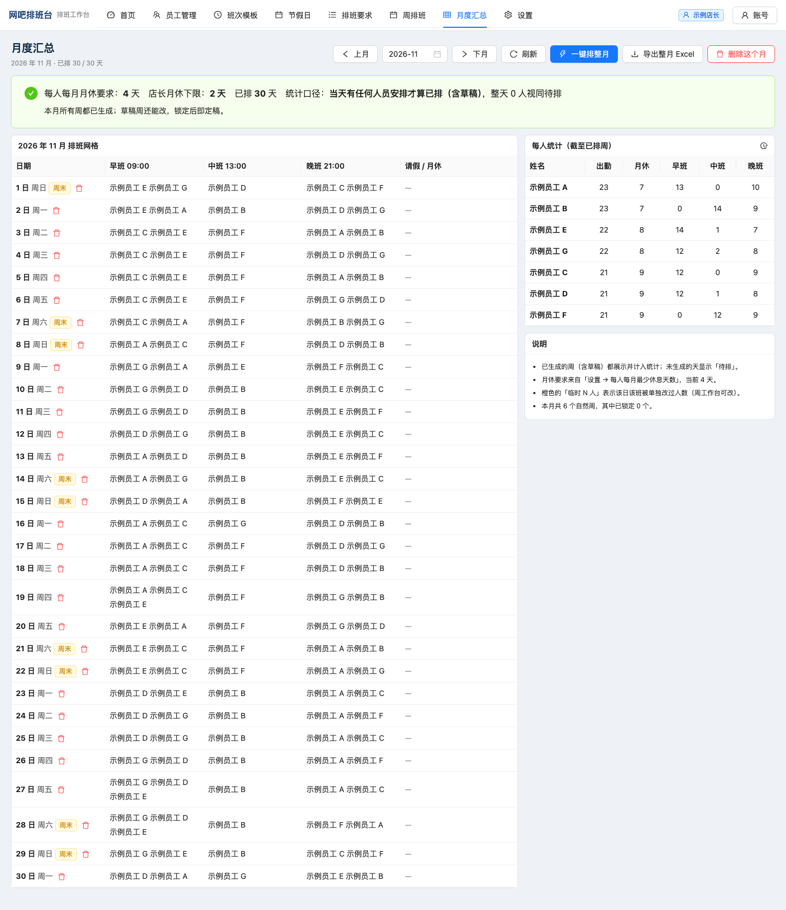
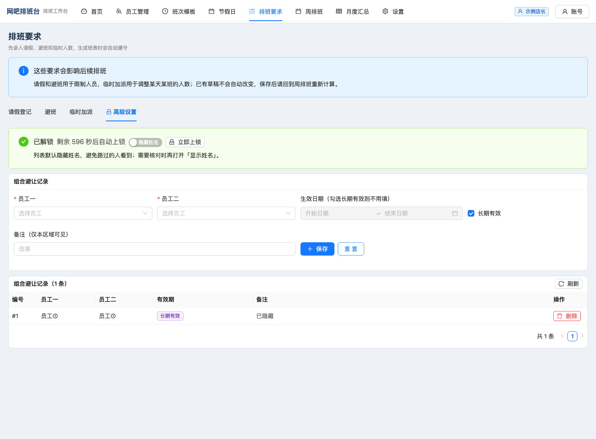
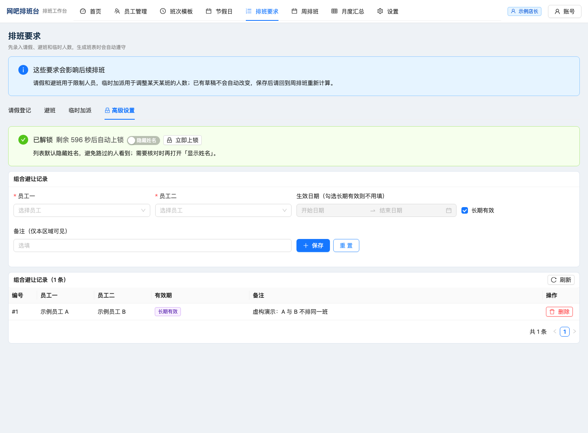

# 网吧排班台

[源码仓库](https://github.com/xfei4569/wangba-scheduler) · [版本下载](https://github.com/xfei4569/wangba-scheduler/releases)

垃圾大王，坚持自主研发垃圾。

这次帮店长写了个排班软件。

本来以为就是填几个格子。
后来发现，每个格子都有意见。

一个给单店三班倒使用的本地排班工具：管理员工、配置规则、生成周/月班表、手动改班、检查冲突、导出 Excel。

## 做到了什么

- 员工入离职、内外场、新老员工、带教与店长角色。
- 早中晚班模板，平日、周末、节假日分别设置人数。
- 请假、长期避班、临时加人，以及需要单独口令解锁的组合避让设置。
- 自动生成与重排；保留过去安排、手工条目和已锁定内容。
- 周工作台、月度汇总、周/月 Excel 导出。
- 缺员与冲突诊断、出勤和晚班统计、每日及手动备份。

机器负责算班。什么叫公平，最后还是人定规则。

适合单店三班倒排班。初次启动使用空数据库，可通过 `npm run demo` 添加虚构员工试用。

## 先跑起来

需要 **Node.js 22.16+ 或 24 LTS**、npm，以及首次安装依赖的网络连接。SQLite 驱动含原生模块：如果没有适合当前平台的预编译文件，需要本机编译工具。

```bash
npm ci --include=dev
npm run setup
npm run dev
```

打开 <http://127.0.0.1:3899>。

`setup` 会在本机生成随机账号、随机密码和签名密钥，保存到 `.env`，终端显示登录方式。仓库没有通用账号密码。已有 `.env` 不会被覆盖；如果你自己复制了空的 `.env.example`，请手动填写账号、至少 12 字符的密码和至少 32 字符的 `JWT_SECRET`。

页面首次访问 API 时自动建空库并预置班次。想先试用，在页面打开一次后另开终端执行：

```bash
npm run demo
```

它只向空员工表写入 7 名虚构员工；已有员工时跳过。刷新员工页即可看到。随后到周排班或月度汇总生成班表。

正式本机运行：

```bash
npm run build
npm start
```

Windows 安装上述 Node.js 后可以双击 `start.bat`，首次安装依赖、生成本机配置并构建。Mac 可双击 `启动排班台.command`，然后手动打开网址。下载内容为源码，需要自行安装依赖；不含 Windows 离线运行包。Windows 启动器的实机兼容性尚未确认。

## 画面

以下截图使用虚构的“示例员工 A”至“示例员工 G”。月度班表为草稿，实际结果取决于人员和规则。





## 怎么用

1. 在员工页录入人员，设置班次人数、休息与相关要求。
2. 在周工作台生成班表；排不下先看缺口和冲突，再决定调整人员还是规则。
3. 手工换人或调整未来安排；检查后锁定。
4. 在月度页查看出勤、月休和晚班分布，导出 Excel。
5. 设置页可以备份数据库；备份应另存一份，避免电脑故障一起丢失。

## 高级设置 把不方便写在班表上的规则单独放好

有的排班要求是“周五请假”。
有的排班要求是“这两个人别排同一班”。

后者放在高级设置里，让引擎执行规则，也避免把具体组合直接写在普通界面上。

### 在哪里打开

登录后进入 **排班要求 → 高级设置**。首次使用时自行设置店长口令（至少 4 位）；这道口令与登录密码独立，仓库不提供预设口令。

### 可以设置什么

- **组合避让，也就是不搭班**：选择两名员工，要求生成班表时避开把他们排在同一天的同一个班次。例如“示例员工 A 与示例员工 B 不排同一班”。不是禁止两人同一天上班或任何时段重叠。
- **生效时间**：可选一个日期区间，或设为长期有效。
- **备注与删除**：可在此区域记录原因，也能删除失效规则；不需要把原因写进员工姓名或普通班表。
- **默认隐藏姓名和备注**：解锁后的规则列表默认使用代号并隐藏备注，需要核对时再切换“显示姓名”。录入表单的人员选择框仍显示姓名。

新增要求不会自动改掉已有草稿。保存后回到周排班重新计算；已开始的安排、手工条目和已锁定内容仍按既有保护规则处理。若手工安排留下冲突，先查看提示，再决定如何调整。

### 怎么上锁和隐藏入口

- 解锁有倒计时，默认 **10 分钟**；“设置 → 高级设置”中可调整为 1—240 分钟，也能修改店长口令。
- 离开前台前可在规则页点 **立即上锁**。
- 可开启 **隐蔽模式**：隐藏排班要求中的高级设置标签；通过 `/requirements?tab=advanced`，或双击“排班要求”标题重新显示入口。显示入口仍需口令解锁，不是绕过口令。

### 上锁 解锁和不搭班规则的画面

以下用虚构员工演示上锁、解锁和不搭班规则。

**上锁状态**：先输入独立的店长口令才能查看组合记录。截图中的“已加密”是现有界面用语，表示口令锁定；数据库文件本身没有加密。


**已解锁，默认遮挡姓名**：可以录入规则，列表默认使用代号并隐藏备注；录入表单的员工选择框仍会显示姓名。



**主动显示规则明细**：打开“显示姓名”后，可以核对“示例员工 A 与示例员工 B 不排同一班”的长期规则和演示备注。需要重新计算班表后，新增规则才参与排班。



### 普通界面会看到什么

未解锁时不能读取具体组合记录；相关冲突以聚合提示呈现，例如“有若干处保密约束冲突，详情需在高级设置输入口令查看”，不把具体配对姓名、对应日期和班次直接展示出来。解锁后才查看明细。普通请假、避班等非保密原因仍正常显示姓名。

它提供的是额外口令、界面遮挡和接口访问控制。界面虽然使用“已加密”字样，**SQLite 数据库文件本身没有加密**；能读取本机数据库或备份的人仍可能看到这些记录。隐藏入口也不是另一种安全认证。

另外，“设置 → 排班规则”里的 **高级调参** 是调整各条软规则的评分权重，与这里存放组合避让的高级设置是两回事；不确定影响时保留默认值。


## 别对这堆东西期待过高

- 适合一个管理员在本机使用，不是多门店 SaaS。默认只监听 `127.0.0.1`，不建议直接暴露到公网。
- 自动排班是约束与评分搜索，不保证得到全局最优解。人数不足时应调整现实安排，不靠软件凭空长出员工。
- 出勤和晚班均衡是优化目标；可用性、请假和组合避让可能让结果有差异，手工强改也可能留下冲突提醒。
- 内置节假日有明确的年份范围；预估项会标记，使用前请自行核对。不会自动获取未来所有年份。
- 数据保存在本机，但依赖安装需要联网。请勿把运行目录里的数据库或 `.env` 上传到 GitHub。

## 本地开发

```bash
npm run typecheck
npm test
npm run build
npm run test:integration
npm run check:public
```

`npm test` 运行登录配置、排班引擎与 Excel 回读测试。`test:integration` 会在独立端口和临时数据库中运行 API 测试。请勿将测试脚本连接到正在使用的班表。

`check:public` 检查发布目录里的运行数据、私人路径与常见凭据模式，不等于完整安全审计。要发源码时使用干净目录，排除 `node_modules/`、`.next/`、`.env`、`data/` 和 `backup/`。

技术栈：Next.js 15、React 18、TypeScript、Ant Design、better-sqlite3、xlsx-js-style。版本内容见 [CHANGELOG](CHANGELOG.md)，依赖说明见 [THIRD_PARTY_NOTICES](THIRD_PARTY_NOTICES.md)。

## 许可与贡献

项目源码采用 [MIT](LICENSE)。第三方依赖各自遵循其许可证。

欢迎带最小复现来提问题，也欢迎带合成数据来修问题。不要在 Issue、截图或附件里放真实员工姓名、班表、密码和数据库。参见 [贡献说明](CONTRIBUTING.md)。

如有实用，纯属意外。
